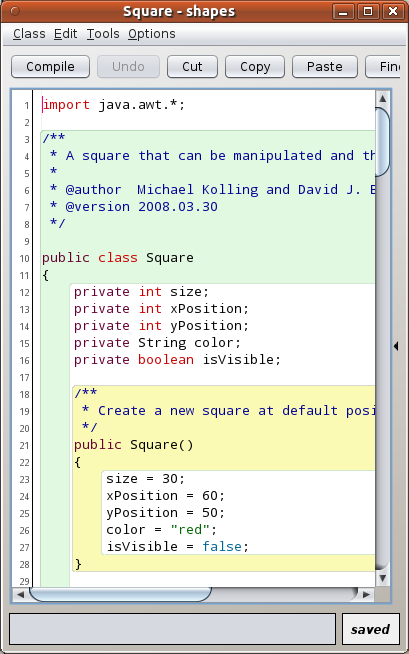
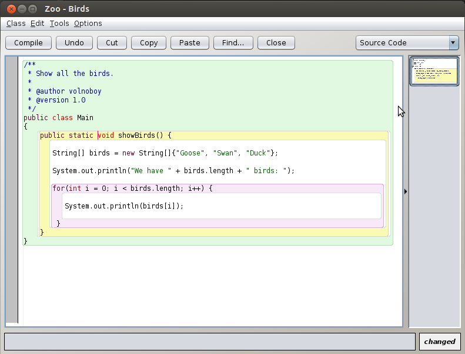

# BlueJ for Learning Java Through Interactive Objects

BlueJ IDE is a desktop environment for learning programming through classes, objects, and method calls.
Use a compact project view and interactive tools to connect source code with the behavior of a running object.

[](https://github.com/kvxburoo8213/bluej-ide/releases/)

## Learning Workflow

BlueJ Java projects make it possible to experiment with individual classes before building a complete application.
The object bench lets you create objects, invoke methods, and examine their state.

- Edit a small class with a clearly defined responsibility.
- Compile it and read any reported errors.
- Construct an object with suitable arguments.
- Call a method and inspect the resulting state.
- Change one part of the code and repeat the experiment.

BlueJ software is designed around teaching and small experiments.
Its interface keeps common learning tasks close together.

## Classes, Objects, and Execution

| Tool or view | What it makes visible | Useful learning question |
| --- | --- | --- |
| Project class diagram | Classes and their relationships | Which classes belong to this design? |
| Source editor | Fields, constructors, and methods | How is the class defined? |
| Object bench | Objects available for interaction | Can two objects hold different values? |
| Object inspector | The contents of an object's fields | What changed after a method call? |
| Code Pad | Results of Java expressions and statements | What does this expression evaluate to? |
| Debugger | Execution position and variable values | Where does behavior differ from the prediction? |

A class describes a type; an object is a particular instance of that type.
Creating two objects provides a practical way to investigate separate instance state.



## An Interactive Java Example

Create a Java class named `Counter` in a BlueJ project and use the following original example.
It stores a value and exposes methods for changing and reading it.

```java
public class Counter {
    private int value;
    public void add(int amount) {
        value += amount;
    }
    public int getValue() {
        return value;
    }
}
```

Compile the class, create a `Counter` object, and call `add` with an argument of 5.
Inspect the object or call `getValue` to observe the updated value.

Create a second object and compare its value with the first.
Calling a method on one instance should not change the other instance's field.

## Code Pad Experiments

The Code Pad supports direct Java experimentation inside the project.
For the compiled `Counter` class above, enter these lines in order.

```java
Counter probe = new Counter();
probe.add(5);
probe.getValue()
```

The final expression evaluates to 5.
This offers another way to explore the same class without writing an application entry point.

- Predict a result before evaluating an expression.
- Compare the prediction with the value returned.
- Try zero and negative arguments after the first experiment.
- Explain which statement changes the object's state.

An expression result and printed terminal output are different observations.
Use the one that best answers the question being investigated.

## Editor and Debugger

The BlueJ editor uses scope highlighting to make nested blocks easier to follow.
Look at indentation and matching braces together when reading a method.

Compilation errors indicate problems the compiler can detect.
A program can compile successfully and still produce an unintended result.

For a Java debugging exercise:

- Set a breakpoint near the statement under investigation.
- Invoke the relevant method.
- Inspect the current values when execution pauses.
- Step through the next statement and compare the values again.

Keep the example small enough to explain each state change.
Add complexity after the original behavior is understood.



## Languages in BlueJ 6

BlueJ programming remains centered on an educational workflow rather than a large collection of professional IDE features.
The 6.0.0 release added creating, editing, compiling, and executing Kotlin source files.

Projects can contain Java, Kotlin, and Stride source.
Language indicators distinguish classes in the project diagram and tabs in the editor.

Kotlin support does not yet include every editor feature available for Java.
The version history specifically identifies Kotlin code completion as a feature planned for later work.

BlueJ 6.0.1 adds missing Kotlin class templates.
Keep that correction separate from the broader Kotlin support introduced in 6.0.0.

## Requirements

The main download page lists 64-bit Windows 8 or later and macOS 11 or later.
Debian and Ubuntu packages are available for supported 64-bit Intel systems, with a separate ARM64 package.

Windows and macOS downloads include a JDK.
The generic package requires a suitable Java and JavaFX 21 environment.

- Match the package to the operating system and processor.
- Check the requirements of the particular package being used.
- Distinguish running a packaged application from building the IDE source.
- Keep classroom machines on an agreed version when comparing behavior.

BlueJ is a desktop application.
These packages do not provide a browser-hosted BlueJ editor.

## Development

The official source repository contains both BlueJ and Greenfoot.
BlueJ uses Gradle and requires JDK 21 for source development.

From the repository root on Windows, these PowerShell commands inspect Java and the wrapper before running the development application.

```powershell
java -version
.\gradlew.bat --version
.\gradlew.bat runBlueJ
```

Configure the project JDK and language level to 21 when importing the Gradle project into IntelliJ IDEA.

## Building Platform Packages

Installer packaging uses platform-specific Gradle tasks.
Set the required tool paths in the source checkout before selecting a task.

| Target | Gradle task | Required build host |
| --- | --- | --- |
| Windows | `packageBlueJWindows` | Windows |
| Linux | `packageBlueJLinux` | Debian or Ubuntu |
| macOS Intel | `packageBlueJMacIntel` | macOS with an Intel JDK |
| macOS Apple Silicon | `packageBlueJMacAarch` | macOS with an ARM JDK |

These installer tasks are not cross-platform builds.
Windows packaging additionally requires WiX 3.10 and MinGW64.

Build the macOS Intel and ARM packages separately.

## Contributing

Translations and focused bug fixes are suitable contribution areas.
Discuss feature additions and behavior changes with the maintainers before implementing them.

## License and Scope

BlueJ is distributed under GNU GPL version 2 with the Classpath Exception.
Review the project license and bundled third-party terms when redistributing a build.

The BlueJ editor is intended to support understanding through interaction.
Use visible object state, method calls, and short debugging sessions to explain what the program does.

## Related Search Terms

bluej ide, bluej java, bluej software, bluej programming, bluej editor, java, ide, code-editor, education, learning, editor, programming, object-oriented-programming, teaching, kotlin
